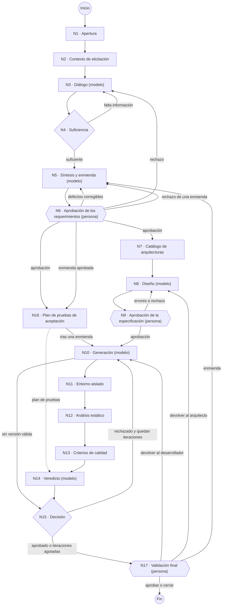

# Arquitectura final del sistema

Arquitectura vigente al 4 de noviembre de 2026: `docs/arquitectura.md` versión 1.5, con los
requerimientos 1.3.

Sirve para rehacer en el documento de tesis:
- la Figura 8, el grafo de diecisiete nodos;
- la Tabla 35 del Anexo E, los nodos;
- las secciones 3.3, 3.7 y 3.8.

El texto completo de cada vista está en `docs/arquitectura.md`.

## 1. Los diecisiete nodos

| Nodo | Agente | Responsabilidad vigente | Naturaleza | Modelo |
|---|---|---|---|---|
| N1 | Elicitador | Apertura de la sesión: crea el identificador, carga la plantilla, inicializa el registro de información capturada y fija el presupuesto de la sesión. | Determinística | — |
| N2 | Elicitador | Recuperación de contexto de las colecciones de elicitación y de dominio de negocio. | Recuperación | — |
| N3 | Elicitador | Diálogo: formula la siguiente pregunta estratégica y extrae la información de la respuesta. Antes del resumen, pregunta por los casos límite de las reglas capturadas, hasta tres y cada uno de un patrón distinto, y una vez por algo más. El resumen que confirma el cliente lo arma el código. Límite de 18 turnos. | Modelo de lenguaje | gpt-5.4-mini |
| N4 | Elicitador | Control de suficiencia: decide si cerrar la elicitación o devolver el flujo a N3. | Determinística | — |
| N5 | Elicitador | Síntesis: produce las historias de usuario y los requerimientos formales. Con una enmienda desde N17, incorpora la regla nueva a los requerimientos vigentes, sin agregar, quitar ni renumerar requerimientos ni escenarios, y sube de versión los que cambian. | Modelo de lenguaje | gpt-5.4-mini |
| N6 | Elicitador | Verificación de los atributos de calidad (RF-07) y aprobación humana. Lo que no requiere al cliente vuelve a N5 para corregirse, hasta dos veces, aunque haya preguntas abiertas; lo demás escala al analista. Durante una enmienda, los defectos que el analista ya había aceptado no vuelven a N5. | Determinística y humana | — |
| N7 | Arquitecto | Recuperación de las seis arquitecturas del catálogo cerrado y de la metodología de selección. | Recuperación | — |
| N8 | Arquitecto | Selección, justificación y parametrización: registro de decisión, especificación de diseño y recorrido de cada escenario de aceptación con interfaces públicas. Los métodos se declaran como `Clase.metodo`. Si el revisor dejó observaciones, el registro gana una revisión con la respuesta y los cambios. | Modelo de lenguaje | gpt-5 |
| N9 | Arquitecto | Validaciones del Anexo B (esquema y ausencia de ciclos, cobertura de los requerimientos y catálogo tecnológico), escenarios ejecutables con sus recorridos, firmas con tipos y funciones de módulo sin `self`; luego, aprobación humana. Devuelve a N8 hasta dos veces. | Determinística y humana | — |
| N10 | Desarrollador | Generación del módulo: código, documento de uso y pruebas, con una prueba por escenario que sigue su recorrido. Antes de entregar verifica la estructura y el estilo que rechazaría el tester, y reintenta una vez. Tras un rediseño, parte de la versión anterior y de la retroalimentación. Sin recuperación de contexto. | Modelo de lenguaje | gpt-6.1-sol |
| N11 | Tester | Ejecución del código y de sus pruebas en un contenedor efímero, sin red, de solo lectura y sin root. | Determinística | — |
| N12 | Tester | Análisis estático de estilo y seguridad con Ruff, conformidad arquitectónica (funciones, clases y métodos), trazabilidad, dinero, secretos y detección de las pruebas que simulan el efecto del módulo (CAL-FS-006). | Determinística | — |
| N13 | Tester | Recuperación de los criterios de calidad aplicables al módulo. | Recuperación | — |
| N14 | Tester | Veredicto por caso del plan de pruebas y retroalimentación estructurada. El juez ve las interfaces y el modelo de datos de la especificación, y cada caso que rechaza se confirma con una segunda opinión. | Modelo de lenguaje | gpt-6-luna |
| N15 | Orquestador | Decisión de enrutamiento: envía a N17 el módulo que aprobó el tester; si no, lo devuelve a N10 mientras queden iteraciones, tres por defecto, y al agotarlas escala la sesión a N17. | Determinística | — |
| N16 | Tester | Plan de pruebas de aceptación: un caso por escenario Gherkin aprobado, en paralelo con N7. Tras una enmienda aprobada, rehace el plan y pasa el control a N10. | Determinística | — |
| N17 | Orquestador | Validación humana final: la persona revisa el reporte y el código y puede ejecutar pruebas propias en el entorno aislado. Aprueba el módulo, lo devuelve con observaciones al desarrollador (N10) o al arquitecto (N8), pide al elicitador (N5) una enmienda con una regla nueva o cierra la sesión. Una sesión escalada no puede aprobarse. | Humana | — |

**Pausa por presupuesto.** Antes de N3, N5, N8, N10 y N14, si lo gastado en la sesión alcanzó su
presupuesto, la sesión pausa. Una persona lo amplía, y queda registrado quién, cuánto, cuándo y por
qué, o cierra la sesión (ADR-0016).

## 2. El flujo

**Cómo leerlo:**
- Las figuras de seis lados son los puntos de control humano.
- Los rombos son decisiones determinísticas.
- La línea punteada es un dato, no un paso: el plan de N16 es la base del veredicto de N14.

### Ciclos, retornos y salidas

- **Dos ciclos:**
  - el conversacional entre N3 y N4, que cierra por suficiencia o al llegar a 18 turnos;
  - el de corrección entre N10 y N15, que cierra por aprobación del tester o al agotar las
    iteraciones.
- **Retornos desde los puntos de control:** cada uno devuelve el flujo al agente anterior con
  observaciones (N6 a N3 y N9 a N8). N17 tiene tres destinos: el desarrollador, el arquitecto y,
  con una enmienda, el elicitador.
- **La enmienda** recorre N5, N6 y N16 y vuelve a N10 con el mismo diseño, sin pasar por N7 a N9.
  Lo pide el RF-39.
- **Devoluciones desde N17:** cada una abre un ciclo de corrección nuevo, con el mismo límite de
  iteraciones.
- **Bifurcación en paralelo:** tras aprobarse los requerimientos, N16 elabora el plan de pruebas
  mientras trabaja el arquitecto.
- **Sin bloqueos:**
  - una falla de salida de un modelo en N5, N8 o N10 se convierte en una decisión del flujo;
  - toda sesión en pausa o detenida puede cerrarse, con su registro, en la fase `cerrada`;
  - el presupuesto pausa la sesión antes del siguiente nodo con modelo.

## 3. Estado compartido

| Partición | Contenido | Nodos que escriben |
|---|---|---|
| sesion | Identificador, cliente, fase, marca de tiempo, espera de entrada, aprobaciones humanas y cierre | N1, N4, N6, N9, N15 y N17 |
| conversacion | Historial de turnos y registro estructurado de información capturada | N3 |
| requerimientos | Historias de usuario y requerimientos formales con su aprobación, y las enmiendas desde N17 | N5, N6, N16 y N17 |
| arquitectura | Registro de decisión con sus revisiones, especificación de diseño validada y recorridos de los escenarios | N8, N9 y N17 |
| codigo | Versiones del módulo, pruebas y documentación | N10 |
| validacion | Plan de pruebas, resultados de ejecución, hallazgos estáticos, conformidad, veredicto y retroalimentación | N10, N11, N12, N14, N16 y N17 |
| contexto | Fragmentos recuperados por colección y contexto descartado | N2, N7 y N13 |
| control | Iteración, límites, costo acumulado, presupuesto y sus ampliaciones | N1, N3, N5, N8, N10, N14 y N15 |

El estado se persiste en PostgreSQL después de cada paso. Así, una sesión se reanuda tras una caída
y se retoma desde otro proceso (RF-28 y RNF-02).

## 4. Modelo de datos

| Entidad | Propósito |
|---|---|
| sesiones | Sesión con su cliente, fase y estado |
| turnos_conversacion | Historial del diálogo |
| historias_usuario | Historias con su trazabilidad a la sesión |
| requerimientos | Requerimientos formales (Anexo A), con su aprobación y las enmiendas |
| decisiones_arquitectonicas | Arquitectura elegida, alternativas descartadas y justificación |
| especificaciones_diseno | Especificación de diseño (Anexo B) |
| artefactos_codigo | Versiones del módulo, pruebas y documentación |
| validaciones | Veredictos por criterio, hallazgos y conformidad |
| aprobaciones_humanas | Decisión, observaciones, revisor y fecha de N6, N9 y N17 |
| ejecuciones | Traza por nodo: inicio, duración, costo y error de cada ejecución (ADR-0016) |
| llamadas_modelo | Cada llamada al modelo, con su prompt y versión, tokens, costo y latencia (ADR-0016) |
| kb_documentos | Documentos de las bases de conocimiento con su colección, fuente y versión |
| kb_fragmentos | Fragmentos con su vector de 1024 dimensiones, su colección y su documento |
| checkpoints | Puntos de control del estado del grafo |

## 5. Bases de conocimiento

| Colección | Contenido | Nodo | Segmentación | Fragmentos |
|---|---|---|---|---|
| elicitacion | Plantillas de historia de usuario y de requerimiento formal, guía de preguntas estratégicas y técnicas de elicitación | N2 | Por sección | 62 |
| dominio_negocio | Terminología y reglas del dominio tributario y catastral | N2 | Por sección | 40 |
| arquitecturas_referencia | Catálogo cerrado de seis arquitecturas, patrones y catálogo tecnológico autorizado | N7 | Una arquitectura o patrón por fragmento | 33 |
| criterios_calidad | 34 reglas verificables derivadas de ISO/IEC 25010, ISO/IEC/IEEE 29119, ISO/IEC 27001 e ISO 9001 | N13 | Una regla por fragmento | 52 |

**Corpus y recuperación:**
- **Corpus:** 36 documentos y 187 fragmentos, con representaciones vectoriales BGE-M3 locales.
- **Recuperación híbrida:** semántica y léxica, con fusión por rango recíproco.
- **Aislamiento:** filtro obligatorio por colección.
- **Relevancia:** umbral de 0,37; los fragmentos descartados quedan en la traza.
- **El desarrollador no tiene recuperación.**

## 6. Modelos de lenguaje

| Nodo | Perfil de diseño | Modelo desplegado |
|---|---|---|
| N3 diálogo | Intermedio | gpt-5.4-mini, versión 2026-03-17 |
| N5 síntesis y enmienda | Intermedio | gpt-5.4-mini, versión 2026-03-17 |
| N8 diseño | Alto | gpt-5, versión 2025-08-07 |
| N10 generación | Alto, el más alto disponible | gpt-6.1-sol, versión 2026-09-29 |
| N14 veredicto | Económico | gpt-6-luna, versión 2026-09-22 |

**Despliegues:**
- Todos son Global Standard, en Azure OpenAI, región South Central US.
- Azure OpenAI es el único proveedor de modelos de lenguaje (ADR-0017).
- Cambiar el modelo de un nodo o su versión es editar la configuración, sin tocar el código
  (RNF-06).
- Cada nodo fija su esfuerzo de razonamiento y su límite de salida (`03-cifras.md`, sección 2).

## 7. Vista de despliegue

**Entrega:** un archivo de composición único (RF-37) levanta todo con un solo comando:
`docker compose up -d --build --wait`.

| Servicio | Qué hace |
|---|---|
| aplicacion | Orquestador, agentes, recuperación e interfaces por consola y web. Llama a Azure OpenAI y crea el entorno aislado mediante el Docker del anfitrión. La web se publica solo en `127.0.0.1:8000`. |
| db | PostgreSQL 16 con pgvector 0.8.6: estado, puntos de control, traza por nodo y bases de conocimiento |
| embeddings | BGE-M3 en Text Embeddings Inference 1.9.4, en CPU y sin conexión externa |
| descarga-modelo | Descarga única y verificada (SHA-256) de los pesos de BGE-M3 |
| ingesta | Migra la base e indexa las bases de conocimiento antes de que arranque la aplicación; es idempotente |
| sandbox | Imagen del entorno aislado. La composición la construye y la comprueba una vez; la aplicación crea con ella un contenedor efímero por ejecución |

**Lo que no se despliega:**
- **Observabilidad:** no es un servicio aparte. La traza por nodo vive en la misma base y se
  consulta desde la consola y la web (ADR-0016).
- **Inferencia local:** no hay un servidor propio de modelos de lenguaje.

**Usuario y archivos:**
- La aplicación corre sin root, con el dueño de `data/local` y el grupo del socket de Docker.
- En `data/local` quedan la traza, las carpetas de trabajo y las exportaciones.

## 8. Seguridad y confidencialidad

- **Código generado:** se ejecuta en un contenedor efímero sin red, de solo lectura y sin root, sin
  acceso al sistema de archivos del anfitrión (RNF-03).
- **Representaciones vectoriales:** se generan localmente (RNF-04).
- **Prompts:** se procesan en Azure OpenAI, dentro de su límite de cumplimiento, con la
  conversación, los fragmentos recuperados y los artefactos. Con datos reales se prefieren los
  despliegues de zona de datos de EE. UU. sobre los globales.
- **Credenciales:**
  - viven en variables de entorno, fuera del control de versiones;
  - no se copian a las imágenes, que se construyen en la máquina donde corren y no se publican en
    ningún registro.
- **Web:**
  - no tiene autenticación y solo responde en la máquina donde corre la composición;
  - el acceso remoto queda como trabajo futuro (ADR-0017).
- **Docker del anfitrión:** la aplicación lo usa únicamente para crear el entorno aislado.
- **Datos de prueba:** todos los casos son sintéticos.

## 9. Qué cambia frente a la Figura 8 y el Anexo E del documento

- **Figura 8 (página 58).** La versión del 4 de noviembre ya muestra:
  - el ciclo conversacional;
  - los rechazos de N6 a N3 y de N9 a N8;
  - la bifurcación hacia N7 y N16, y los casos del plan hacia N14;
  - la generación fallida de N10 a N15 y el ciclo de corrección;
  - el escalamiento a N17, «devuelve a N10 o N8, ciclo nuevo», el cierre y el módulo validado.

  Hay que agregar:
  - una arista discontinua de N17 a N5, «enmienda (RF-39)». La etiqueta del retorno de N17 pasa
    a «devuelve a N10, N8 o, con una enmienda, a N5; ciclo nuevo»;
  - una arista discontinua de N6 a N5, «corrige defectos o rechaza una enmienda»;
  - una arista de N16 a N10, «tras una enmienda aprobada». En una enmienda, N6 pasa solo a N16,
    sin N7, N8 ni N9;
  - en la leyenda o junto a N3, N5, N8, N10 y N14, una marca para la pausa por presupuesto:
    «antes de este nodo, la sesión pausa si alcanzó su presupuesto».
- **Tabla 35 del Anexo E:** reemplazar las responsabilidades por las de la sección 1. Cambian N1,
  N3, N5, N6, N8, N9, N10, N12, N14, N15, N16 y N17.
